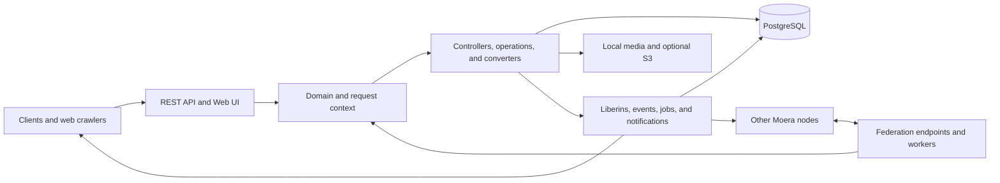

# moera-node architecture

This is the entry point to the architecture of `moera-node`. The document describes the current implementation. It is
organized by stable responsibilities rather than source packages or the sequence in which features were added.

## System context

`moera-node` hosts one or more Moera identities. It provides the public Node API and a limited server-rendered web
interface, stores local and cached remote social data, exchanges signed requests and notifications with other nodes,
and performs durable background work.

## Chapters

1. [Overview](architecture/overview.md) describes the process, major components, source layout, and architectural
   boundaries.
2. [Runtime and node contexts](architecture/runtime.md) describes multi-host routing, request and background contexts,
   transactions, configuration, and execution pools.
3. [API and access control](architecture/api-and-access-control.md) describes the HTTP surfaces, generated protocol
   types, authentication, authorization, and the built-in web interface.
4. [Persistence and social model](architecture/persistence.md) describes PostgreSQL, entries and revisions, feeds,
   contacts, source identity metadata, and media-child links.
5. [Asynchronous processing](architecture/asynchronous-processing.md) describes tasks, persistent jobs, liberins,
   client events, and scheduled maintenance.
6. [Federation](architecture/federation.md) describes naming, remote API calls, signed notifications, picking remote
   content, source URIs, and search subscribers.
7. [Media](architecture/media.md) describes media identity, storage, upload, serving, S3, video processing, OCR,
   remote downloads, and cleanup.
8. [Presentation and integrations](architecture/presentation-and-integrations.md) describes the Web UI, discovery,
   push delivery, mail, link previews, IndexNow, OCR.Space, and FCM relay integration.

## Sources of truth

The architecture explains the code but does not replace executable contracts:

- `src/main/java/org/moera/node` is the source of truth for application behavior.
- `src/main/resources/db/migration` is the source of truth for database evolution.
- `src/main/resources/options.yaml` and the configuration classes under `config` define node-level options and
  deployment configuration.
- `../moeraorg.github.io/_data/node_api.yml` and `../moeraorg.github.io/_data/notifications.yml` define the public Node
  API and notification protocol. Generated types are consumed through `java-moeralib`.
- `doc/create_tables.sql` is a generated database snapshot. It is useful for inspection but is not edited manually.

Detailed endpoint fields and validation rules belong in the public API specification. Exact columns and indexes belong
in Flyway migrations. This document records the relationships and invariants needed to understand and change the
system safely.
