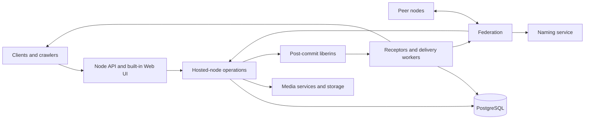

# moera-node architecture

`moera-node` hosts one or more Moera identities: it stores social data, serves the Node API and a limited Web UI,
and exchanges signed notifications with peers. It is a Java/Spring Boot application with PostgreSQL and filesystem
or optional S3 media storage. HTTP handlers and background workers run in the same JVM.

The full browser client, naming service, peer nodes, search index, and FCM relay are separate systems. The chapters
below describe the current implementation and the boundaries a change must preserve.

## System map

Controllers own HTTP validation and permissions; operations coordinate state changes; repositories own database
queries. Controllers also query repositories directly: these are collaborating Spring components, not enforced layers.
Generated protocol structures, persisted entities, and sanitized presentation are separate representations.

## Chapters and change locations

Package names are relative to [src/main/java/org/moera/node](../src/main/java/org/moera/node).

| Chapter | Responsibility | Start a change in |
| --- | --- | --- |
| [Runtime][runtime] | Hosted identities, context, transactions, deployment | `domain`, `global`, `config`, `option` |
| [API and access control][api] | Credentials, scopes, principals, protected output | `rest`, `auth`, `model` |
| [Persistence][persistence] | Content ownership, revisions, references, relationships | `data`, `operations` |
| [Stories and feeds][stories] | Publications, ordering, visibility, deletion, instants | `StoryOperations`, `instant` |
| [Asynchronous processing][async] | Signals, jobs, client delivery | `task`, `liberin`, `event`, `push` |
| [Federation][federation] | Peer protocol and content exchange | `api`, `notification`, `subscriptions`, `picker` |
| [Media][media] | Ownership, attachments, remote downloads, processing | `media`, media operations/controllers |
| [Media storage][storage] | Bytes, serving, S3 migration, physical cleanup | `media`, `media/awss3` |
| [Presentation and integrations][presentation] | Pages, discovery, adapters | `ui`, `text`, adapter packages |

For a feature, follow its state owner and then its side effects: a publication change starts in stories/feeds;
a peer message also involves federation; a permission change must cover every representation listed in access control.

## Representative write

1. MVC interceptors select the hosted node and establish identity/scopes.
2. [PostingController](../src/main/java/org/moera/node/rest/PostingController.java) validates input and permissions,
   verifying signatures before trusting signed identity.
3. `PostingOperations` writes the entry, revision, attachments, references, and publications in the controller
   transaction. Conversion builds the response while required relationships are loaded.
4. The request collects liberins. After successful completion, receptors handle them in separate write transactions
   and create derived state or delivery work.

A completed posting write does not imply successful downstream delivery. The [asynchronous chapter][async] defines
which work survives restart and how post-commit dispatch differs from committed durable intent.

## Sources of truth

- [pom.xml](../pom.xml) and [application.yml](../src/main/resources/application.yml): build and runtime defaults.
- [Configuration classes](../src/main/java/org/moera/node/config) and
  [options.yaml](../src/main/resources/options.yaml): deployment properties and per-node options.
- [Flyway migrations](../src/main/resources/db/migration): schema, indexes, constraints, and triggers.
  `doc/create_tables.sql` is a generated snapshot and must not be edited.
- Sibling [Node API](../../moeraorg.github.io/_data/node_api.yml),
  [notification](../../moeraorg.github.io/_data/notifications.yml), and
  [event](../../moeraorg.github.io/_data/events.yml) specifications: exact wire contracts.

Sibling links require the usual multi-repository checkout. Chapters link to focused implementation and regression
examples rather than reproduce those contracts. Update the affected chapter when ownership, transaction boundaries,
durable work, federation, or deployment requirements change.

[runtime]: architecture/runtime.md
[api]: architecture/api-and-access-control.md
[persistence]: architecture/persistence.md
[stories]: architecture/stories-and-feeds.md
[async]: architecture/asynchronous-processing.md
[federation]: architecture/federation.md
[media]: architecture/media.md
[storage]: architecture/media-storage.md
[presentation]: architecture/presentation-and-integrations.md
